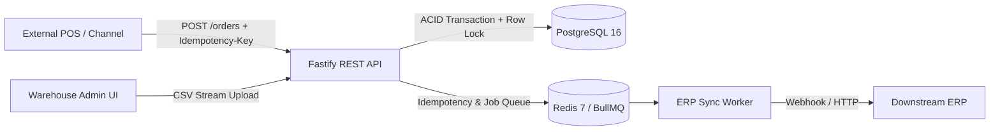

# StockSync Engine

Distributed Order & Inventory Allocation Engine berbasis Node.js dan PostgreSQL. Sistem ini dirancang untuk menangani pemrosesan pesanan dengan tingkat konkurensi tinggi, pencegahan *overselling*, *idempotency* transaksi, serta impor mutasi stok massal tanpa lonjakan konsumsi memori.

## Konteks Masalah & Aktor Sistem

Sistem distribusi dan inventaris multi-channel umumnya menghadapi tiga risiko teknis utama:
1. **Race Condition (Overselling):** Beberapa kanal penjualan memesan SKU yang sama pada milidetik yang bersamaan.
2. **Duplicate Requests:** Kegagalan jaringan menyebabkan sistem klien mengirim ulang permintaan pembuatan order yang sama.
3. **Memory Exhaustion:** Proses impor pembaruan stok puluhan ribu baris secara sinkron membebani RAM server.

### Aktor Pengguna
- **External Channel / POS Client:** Mengirimkan transaksi order melalui REST API menggunakan autentikasi `X-API-Key` dan `Idempotency-Key`.
- **Warehouse & Operations Admin:** Mengelola unggahan stok massal dan memantau antrean sinkronisasi melalui dashboard internal.
- **Downstream ERP System:** Menerima pembaruan status inventaris secara asinkron melalui background worker.

## Arsitektur Sistem


## Tech Stack
Runtime: Node.js v22 LTS (ES Modules)

HTTP Framework: Fastify

Database: PostgreSQL 16 (Connection Pooling + Explicit Row-Level Locking)

Queue & Cache: Redis 7 + BullMQ

Validation & Logging: Zod + Pino (Structured JSON Logging)

Frontend Ops Dashboard: Vue 3 + Vite + Tailwind CSS

Struktur Proyek
```text
stocksync-engine/
├── docker/                 # Skrip inisialisasi database dan konfigurasi container
├── backend/
│   ├── src/
│   │   ├── config/         # Validasi environment, pool PostgreSQL, koneksi Redis
│   │   ├── db/             # Skema tabel, migrasi SQL, dan seeder
│   │   ├── shared/         # Middleware autentikasi, idempotency, error handler, logger
│   │   ├── modules/        # Domain bisnis (auth, inventory, orders)
│   │   └── workers/        # Proses background worker terpisah dari HTTP server
│   └── tests/              # Unit test dan integration/concurrency test
├── frontend/               # Dashboard pemantauan operasional berbasis Vue 3
├── samples/                # Generator dan dataset uji coba skala besar
└── docker-compose.yml      # Orkestrasi layanan infrastruktur dan aplikasi
```
## Progress Iterasi
[x] Iterasi 1: Setup monorepo, Docker Compose (PostgreSQL & Redis), dan Stream CSV Stock Importer.

[x] Iterasi 2: HTTP API layer (Fastify), validasi Zod, error handling terpusat, dan graceful shutdown.

[ ] Iterasi 3: Integrasi PostgreSQL, connection pooling, transaksi ACID (SELECT FOR UPDATE), dan idempotency middleware.

[ ] Iterasi 4: Background worker (BullMQ), structured logging, serta dashboard operasional Vue 3.

## Menjalankan Secara Lokal

### 1. Jalankan Infrastruktur & Backend
```bash
cp .env.example .env
docker compose up -d

cd backend
pnpm install
pnpm dev
```
### 2. Menjalankan Pengujian Otomatis
```bash
cd backend
pnpm test
```
### 3. Uji Stream CSV Importer via HTTP
```bash
# Generate 50.000 baris data uji
pnpm generate:csv

# Unggah file secara streaming ke API
curl -X POST http://localhost:3000/api/v1/inventory/import-stream \
  -F "file=@../samples/bulk-stock-50k.csv;type=text/csv"
```

## Ringkasan Endpoint API (v1)
| Method | Endpoint | Deskripsi |
| :--- | :--- | :--- |
| `GET` | `/health` | Pemeriksaan status runtime dan uptime proses server. |
| `GET` | `/api/v1/inventory/:sku` | Mengambil informasi ketersediaan stok per gudang untuk SKU tertentu. |
| `POST` | `/api/v1/inventory/adjust` | Penyesuaian stok tunggal secara manual (penambahan atau pengurangan). |
| `POST` | `/api/v1/inventory/import-stream` | Unggah dan pemrosesan mutasi stok massal berbasis file CSV (`multipart/form-data`). |
| `POST` | `/api/v1/orders` | Pembuatan pesanan baru dan alokasi pemotongan stok gudang. |
| `GET` | `/api/v1/orders/:id` | Mengambil detail dan status alokasi pesanan berdasarkan UUID. |

